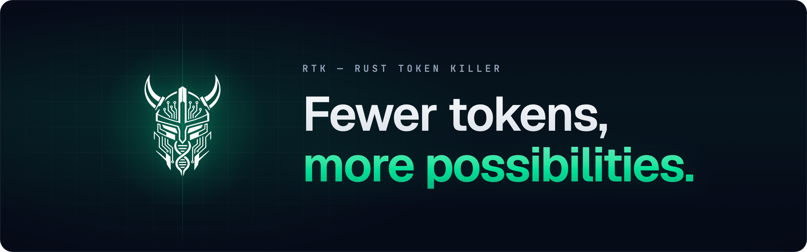
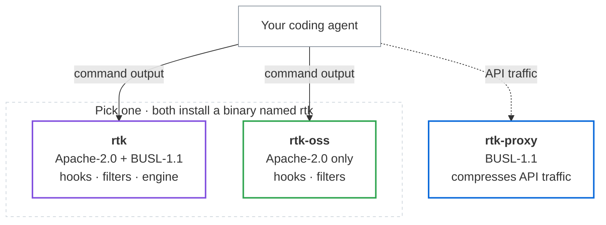

<p align="center">
  
</p>

<p align="center">
  <strong>The cost reduction engine for AI coding agents.</strong>
  <br>
  Install it and forget it, then go as far as you want with pipelines.
</p>

<p align="center">
  <a href="https://github.com/rtk-ai/rtk/actions"></a>
  <a href="https://github.com/rtk-ai/rtk/releases"></a>
  <a href="#editions-and-licence"></a>
  <a href="https://discord.gg/RySmvNF5kF"></a>
  <a href="https://formulae.brew.sh/formula/rtk"></a>
</p>

<p align="center">
  <a href="#install--forget">Install</a> &bull;
  <a href="https://www.rtk-ai.app/pipelines/">Pipelines</a> &bull;
  <a href="https://www.rtk-ai.app/docs/">Docs</a> &bull;
  <a href="https://www.rtk-ai.app">Website</a> &bull;
  <a href="https://discord.gg/RySmvNF5kF">Discord</a>
</p>

<p align="center">
  <a href="README.md">English</a> &bull;
  <a href="README_fr.md">Francais</a> &bull;
  <a href="README_zh.md">中文</a> &bull;
  <a href="README_ja.md">日本語</a> &bull;
  <a href="README_ko.md">한국어</a> &bull;
  <a href="README_es.md">Espanol</a> &bull;
  <a href="README_pt.md">Português</a>
</p>

---

<p align="center">
 <a href="https://www.star-history.com/rtk-ai/rtk">
  <picture><source media="(prefers-color-scheme: dark)" srcset="https://api.star-history.com/badge?repo=rtk-ai/rtk&type=rank&theme=dark" /><source media="(prefers-color-scheme: light)" srcset="https://api.star-history.com/badge?repo=rtk-ai/rtk&type=rank" /></picture> <picture><source media="(prefers-color-scheme: dark)" srcset="https://api.star-history.com/badge?repo=rtk-ai/rtk&type=trending&theme=dark" /><source media="(prefers-color-scheme: light)" srcset="https://api.star-history.com/badge?repo=rtk-ai/rtk&type=trending" /></picture>
 </a>
</p>

**① Install & forget: up to 90% less command output.**
Test runs, diffs, logs and builds are compressed before your agent reads them. 100+ commands, no config, nothing changes in how you work.

**② Go further with pipelines, as far as you take it.**
The community built the bash compressor 85k developers starred. Now it is building pipelines. Hand heavy reads to a cheaper model, compress more than bash, clean the API traffic without breaking the prompt cache. One agent-agnostic file: start from a built-in, install one someone shared, or write and share your own. The best one listed today cuts total cost by 20.2% in its [author's benchmark](https://www.rtk-ai.app/pipelines/).

## Install & forget

```bash
brew install rtk                 # macOS / Linux
winget install rtk-ai.rtk        # Windows
curl -fsSL https://raw.githubusercontent.com/rtk-ai/rtk/refs/heads/master/install.sh | sh

rtk init -g                      # Claude Code; every other agent: see "Works in your agent"
```

Restart your agent. That's it: when it runs `git status`, RTK runs `rtk git status` and the agent reads a 3-line summary instead of 40 lines. Nothing to learn, nothing to call, and upgrading RTK never changes this.

> Another project named "rtk" exists on crates.io. Check you have this one: `rtk gain` must show the savings dashboard, not "command not found".
>
> Cargo, pre-built binaries, native Windows, WSL and uninstall: **[Installation guide](https://www.rtk-ai.app/docs/getting-started/installation/)** · per-agent setup and `--dry-run`: **[Quick Start](https://www.rtk-ai.app/docs/getting-started/quick-start/)**

## Out of the box: the bash compressor

The part 85k developers starred. Built by 200+ contributors, written against real command output, and every filter has to cut at least 20% to ship.

| Operation | What RTK does to the output |
|-----------|-----------------------------|
| `ls` / `tree` | Tree format with file counts instead of one line per entry |
| `cat` / `read` | Smart file reading: signatures and structure over full bodies |
| `grep` / `rg` | Truncates long lines, groups matches by file |
| `ast-grep` | Groups structural matches by file, caps overflow |
| `git status` | Compact stat format, grouped by state |
| `git diff` | Reduced context, headers stripped |
| `git log` | Hash, author and subject only |
| `git add/commit/push` | Confirmation line instead of full progress output |
| `cargo test` / `npm test` | Failures only, passing tests collapsed to a count |
| `ruff check` | Grouped by rule and file |
| `sqlfluff lint` | Grouped by rule and file |
| `pytest` | Failures only, traceback trimmed |
| `go test` | NDJSON parsed, failures only |
| `docker ps` | Essential fields only |

100+ commands across Git, GitHub CLI, Cargo/Rust, JavaScript (npm, pnpm, vitest, jest, tsc, Next.js, Angular, Playwright, Prisma), Python (ruff, pytest, mypy, pip), Go (go test, golangci-lint), Ruby, .NET, JVM (Gradle, Maven), PHP, Docker, Kubernetes, AWS, Terraform, and the file/search builtins. Every command and its filter: **[What RTK Optimizes](https://www.rtk-ai.app/docs/resources/what-rtk-covers/)**

Four strategies, picked per command: **filtering** removes noise (progress bars, boilerplate, blank lines), **grouping** aggregates similar items (files by directory, errors by type), **truncation** keeps the relevant context, **deduplication** collapses repeated lines with a count.

Three promises:

- **Never blocks.** If a filter fails, you get the raw output, and the command's exit code is passed through unchanged.
- **Never worse.** RTK never prints more than the command did.
- **Nothing hidden.** Output that is cut says where the full version is, and `rtk bypass` runs any command unfiltered, still tracked in `rtk gain`:

```bash
rtk bypass git log --oneline -20        # full git log, no truncation
rtk bypass npm install express          # raw npm output
```

The hook rewrites shell commands. Built-in tools such as `Read`, `Grep` and `Glob` pass through untouched on the default pipeline; in Claude Code, `rtk:posthook` compresses them too (see below).

> **Does RTK break the prompt cache?** No. RTK filters output once per command. The result is stored in history and cached normally on later API calls, and smaller outputs mean cheaper cache writes and reads. See [Troubleshooting](docs/guide/resources/troubleshooting.md#does-rtk-break-claudes-prompt-cache).

## Go further with pipelines

Everything RTK does is written in one file, `pipeline.toml`: where RTK acts, when, and what it does. With no file you are on `rtk:default`, which is exactly the compressor above. Everything else is opt-in, one line at a time.

| Where RTK acts | What it can do | On by default |
|---|---|---|
| Before a tool runs (agent hooks) | Rewrite a shell command through `rtk`, block a call, or route it to a cheaper model | Shell rewrite |
| After a tool runs (agent hooks) | Compress the output before the agent reads it | No: `rtk:posthook` |
| API traffic ([RTK Proxy](#rtk-proxy-optional)) | Strip ANSI codes, progress bars and repeated lines from tool results, place the cache breakpoint, carry delegated calls | Noise stripping, once the proxy runs |
| Agent instructions (directives) | Tell the agent how to write and which commands to use | RTK awareness |
| Tasks | Commands that hand heavy work to a cheaper model you choose | No: needs a model |

Built-in pipelines, each one line away:

| Pipeline | What it adds | Works in |
|---|---|---|
| `rtk:default` | The bash compressor. What you have with no pipeline file | Every agent with a hook |
| `rtk:posthook` | Compresses `Read`, grep and web output too, not just shell commands | Claude Code |
| `rtk:delegate-reads` | Whole-file reads over 350 lines are answered by a cheaper model: the file never enters the agent's context | Claude Code, with a model you choose |
| `rtk:proxy` | Places the prompt-cache breakpoint for clients that set none | Agents you can point at the RTK Proxy |
| `rtk:terse` | The agent writes terse prose; code, paths, commands and errors stay in full | Every agent with RTK's instruction file |

```toml
# ~/.config/rtk/pipeline.toml
[pipeline]
extends = ["rtk:posthook", "rtk:proxy"]
```

`rtk pipeline show rtk:default` prints the built-in file. Change one line of it, or write your own rules.

**Agent-agnostic.** You write `shell`, `read`, `before_tool`; RTK translates them to each agent's hooks. A pipeline written once works in every agent RTK supports, as far as that agent's hooks allow: **[Agent Coverage](https://www.rtk-ai.app/docs/resources/agent-coverage/)** shows exactly what runs where.

**Share yours, or install one.**

```bash
rtk pipeline share publish               # publish your pipeline: GitHub repo or gist
rtk pipeline add github:user/repo        # validate and install a shared pipeline
rtk gain                                 # what it saved on your own traffic
```

**[rtk-ai.app/pipelines](https://www.rtk-ai.app/pipelines/)** lists pipelines with what each one saved and how it was measured. More are tagged [`rtk-pipeline`](https://github.com/topics/rtk-pipeline) on GitHub. A pipeline can rewrite commands and send content to the models it declares, so read its file before you install it.

> The tour: **[Pipelines](https://www.rtk-ai.app/docs/pipelines/overview/)** · the reference: **[Writing a Pipeline](https://www.rtk-ai.app/docs/pipelines/writing-pipelines/)**, **[Conditions and Judges](https://www.rtk-ai.app/docs/pipelines/conditions/)**, **[Methods](https://www.rtk-ai.app/docs/pipelines/methods/)**, **[Tasks and Upstreams](https://www.rtk-ai.app/docs/pipelines/tasks/)**, **[Reference Pipelines](https://www.rtk-ai.app/docs/pipelines/reference-pipelines/)** · the commands: **[Pipeline Commands](https://www.rtk-ai.app/docs/pipelines/commands/)** · your own methods: **[Plugins](https://www.rtk-ai.app/docs/pipelines/plugins/)**

## RTK Proxy (optional)

The `rtk-proxy` daemon runs the same pipeline on your agent's **provider-API traffic**. It sits between your agent and the provider: it strips bytes no model ever needed before forwarding, without breaking the prompt cache, and carries the calls your pipeline routes to cheaper models, so they borrow the credential your agent already sends and show up in `rtk gain`. It can also place prompt-cache breakpoints where the agent leaves them open (opt-in).

```bash
rtk claude              # start the daemon if needed, then launch Claude through it
rtk llm-proxy status    # is it up
rtk gain                # savings, command filtering and proxy side by side
```

**Two independent ways in**, because not every harness has a session hook:

| | What it does |
|---|---|
| `rtk init -g` | Offers to set it up once: writes the base URL and the `rtk:proxy` pipeline, then asks how the daemon should come back after a reboot — SessionStart hook, background service, or neither. |
| `rtk <harness>` | No configuration at all. Starts the daemon, points the harness at it, then execs it. Needs no hook system, which is why it covers harnesses that have none. |

`rtk <harness>` resolving is itself the signal that traffic really goes through the daemon — the subcommand exists only where redirection is verified. Today that is `rtk claude`. A harness without one is never silently unproxied: it falls through to plain passthrough, and `rtk llm-proxy setup` lists what can be launched.

It is a separate binary under a separate licence (BUSL-1.1), shipped as its own `rtk-proxy-<target>` archive — `rtk` never links it. Not the same thing as `rtk bypass`, which runs one local command unfiltered (`rtk proxy <cmd>` is its deprecated alias).

> Setup and subcommands: **[RTK Proxy](https://www.rtk-ai.app/docs/proxy/overview/)** · what it compresses: **[What the Proxy Compresses](https://www.rtk-ai.app/docs/proxy/compression/)** · settings and endpoints: **[Proxy Configuration](https://www.rtk-ai.app/docs/proxy/configuration/)**

## Works in your agent

RTK supports 18 AI coding tools. Where the agent offers a hook, `rtk init` installs it and compression is automatic; where it only reads a rules file, RTK asks the model to use `rtk` commands.

| Tool | Install | Method |
|------|---------|--------|
| **Claude Code** | `rtk init -g` | PreToolUse hook (native binary) |
| **GitHub Copilot (VS Code)** | `rtk init -g --copilot` | PreToolUse hook — transparent rewrite |
| **GitHub Copilot CLI** | `rtk init -g --copilot` | PreToolUse deny-with-suggestion (CLI limitation) |
| **Cursor** | `rtk init -g --agent cursor` | preToolUse hook (hooks.json) |
| **Gemini CLI** | `rtk init -g --gemini` | BeforeTool hook |
| **Codex** | `rtk init -g --codex` | PreToolUse hook (`updatedInput`) + AGENTS.md |
| **Windsurf** | `rtk init -g --agent windsurf` | .windsurfrules (project-scoped) |
| **Cline / Roo Code** | `rtk init --agent cline` | .clinerules (project-scoped) |
| **OpenCode** | `rtk init -g --opencode` | Plugin TS (execute.before / tool.execute.before), needs 1.18.29 or newer |
| **OpenClaw** | `openclaw plugins install ./openclaw` | Plugin TS (before_tool_call) |
| **Pi** | `rtk init -g --agent pi` (global) | TypeScript extension (tool_call) |
| **Oh My Pi (OMP)** | `rtk init -g --agent omp` (global) / `rtk init --agent omp` (project) | TypeScript extension (tool_call, shared with Pi) |
| **Hermes** | `rtk init --agent hermes` | Python plugin adapter (terminal command mutation via `rtk rewrite`) |
| **Mistral Vibe** | `rtk init -g --agent vibe` | `pre_tool` hook (hooks.toml) |
| **Kilo Code** | `rtk init --agent kilocode` | .kilocode/rules/rtk-rules.md (project-scoped) |
| **Google Antigravity** | `rtk init --agent antigravity` / `rtk init -g --agent antigravity` | .agents/plugins/rtk/ (project) or ~/.gemini/config/plugins/rtk/ (global): plugin.json, hooks.json, rules/AGENTS.md |
| **Kimi AI** | `rtk init --agent kimi` | AGENTS.md (project-scoped) |
| **Factory Droid** | `rtk init -g --agent droid` (or per-project) | PreToolUse hook in `~/.factory/hooks.json` (matcher `Execute`) |
| **Trae** | `rtk init --agent trae` | Native `PreToolUse` hook in `.trae/hooks.json` (`RunCommand`) |
| **Trae (global)** | `rtk init -g --agent trae` | `~/.trae/hooks.json`, plus `~/.trae-cn/hooks.json` when that directory exists |

Per-agent setup, override controls and graceful degradation: **[Supported Agents](https://www.rtk-ai.app/docs/getting-started/supported-agents/)**. The Hermes plugin source and tests live in `hooks/hermes/`; installed Hermes runtime files still live under `~/.hermes/plugins/rtk-rewrite/`.

## Measure it

```bash
rtk gain                        # Summary stats
rtk gain --graph                # ASCII graph (last 30 days)
rtk gain --history              # Recent command history
rtk gain --daily                # Day-by-day breakdown
rtk gain --all --format json    # JSON export for dashboards

rtk discover                    # Find missed savings opportunities
rtk discover --all --since 7    # All projects, last 7 days

rtk session                     # Show RTK adoption across recent sessions
```

**What the numbers mean.** The compressor reduces the **command output** your agent reads. That is what it measures, and it is not the same as cutting your bill by the same amount. Command output is **one contributor to input tokens**, alongside your prompt, the system prompt and conversation history. Input tokens are in turn **only part of the bill**, which also counts output tokens. The reduction dilutes at every step. The token counts RTK reports are estimated as `bytes / 4` — RTK ships no tokenizer, so the **percentages are reliable but the absolute token numbers are approximate**.

> Full explanation: [How RTK Savings Work](docs/guide/resources/savings-explained.md) · attribution, the live dashboard and export formats: **[Token Savings Analytics](https://www.rtk-ai.app/docs/analytics/gain/)**

## Documentation

**[rtk-ai.app/docs](https://www.rtk-ai.app/docs/)** is the full user guide.

| | |
|---|---|
| [Installation](https://www.rtk-ai.app/docs/getting-started/installation/) | every install method, Windows, WSL, uninstall |
| [Quick Start](https://www.rtk-ai.app/docs/getting-started/quick-start/) | per-agent init, `--dry-run`, first savings |
| [Supported Agents](https://www.rtk-ai.app/docs/getting-started/supported-agents/) | setup detail, override controls, degradation |
| [Agent Coverage](https://www.rtk-ai.app/docs/resources/agent-coverage/) | what each agent's hook API lets RTK do |
| [What RTK Optimizes](https://www.rtk-ai.app/docs/resources/what-rtk-covers/) | every command and its filter |
| [Configuration](https://www.rtk-ai.app/docs/getting-started/configuration/) | `config.toml`, env vars, recall recovery |
| [Token Savings Analytics](https://www.rtk-ai.app/docs/analytics/gain/) | `rtk gain` in full |
| [Pipelines](https://www.rtk-ai.app/docs/pipelines/overview/) | the engine: `pipeline.toml`, rules, judges, tasks, sharing |
| [RTK Proxy](https://www.rtk-ai.app/docs/proxy/overview/) | the daemon: setup, what it compresses, settings |
| [Editions and Licensing](https://www.rtk-ai.app/docs/resources/editions/) | what each download contains |
| [Telemetry & Privacy](https://www.rtk-ai.app/docs/resources/telemetry/) | what is collected, how to opt in, your GDPR rights |
| [Troubleshooting](https://www.rtk-ai.app/docs/resources/troubleshooting/) | common issues, prompt-cache questions |

Repository references: [engine/README.md](engine/README.md) · [proxy/README.md](proxy/README.md) · [ARCHITECTURE.md](docs/contributing/ARCHITECTURE.md) · [CONTRIBUTING.md](CONTRIBUTING.md) · [SECURITY.md](SECURITY.md)

RTK collects **no command content and no file contents**. Telemetry is anonymous and **off by default** — it sends nothing until you opt in with explicit consent (GDPR Art. 6 & 7) via `rtk telemetry enable`, and documented in [Telemetry & Privacy](https://www.rtk-ai.app/docs/resources/telemetry/).

## Editions and licence

RTK ships as three downloads. The two `rtk` editions install a binary with the **same name** — hooks, scripts and agent config work unchanged across both — so they cannot be installed together. Uninstall one before installing the other.



| Download | Licence | Contains |
|---|---|---|
| `rtk-<target>` | Apache-2.0 + BUSL-1.1 | Hook core, every command filter, **and** the pipeline engine |
| `rtk-oss-<target>` | Apache-2.0 only | Hook core and every command filter. No engine. |
| `rtk-proxy-<target>` | BUSL-1.1 | The RTK Proxy daemon. Never bundled with either `rtk`. |

**Production use is free**, engine and daemon included. What the BUSL grant does not cover is offering RTK or a derivative to third parties as a commercial product or service — for that, contact **contact@rtk-ai.app**.

```bash
curl -fsSL .../install.sh | RTK_EDITION=oss sh    # Apache-2.0 edition
brew install rtk-ai/tap/rtk-oss
```

The `rtk` CLI is **Apache-2.0** — see [LICENSE](LICENSE). It links one component under a different licence: `rtk-engine` (`engine/`) is **BUSL-1.1**, source-available: see [engine/LICENSE](engine/LICENSE). Its Additional Use Grant permits production use as part of the `rtk` binary, so running `rtk` is covered; using the engine on its own, or inside another product, is not until the Change Date. The `rtk-proxy` daemon (`proxy/`) is **BUSL-1.1** on the same terms and ships as its own archive with its licence alongside — `rtk` never links it.

> What the Apache-2.0 edition omits and where the licence boundary falls: **[Editions and Licensing](https://www.rtk-ai.app/docs/resources/editions/)**

## Star History

<a href="https://www.star-history.com/?repos=rtk-ai%2Frtk&type=date&legend=top-left">
 <picture>
   <source media="(prefers-color-scheme: dark)" srcset="https://api.star-history.com/chart?repos=rtk-ai/rtk&type=date&theme=dark&legend=top-left" />
   <source media="(prefers-color-scheme: light)" srcset="https://api.star-history.com/chart?repos=rtk-ai/rtk&type=date&legend=top-left" />
   
 </picture>
</a>

## StarMapper

<a href="https://starmapper.bruniaux.com/rtk-ai/rtk">
  <picture>
    <source media="(prefers-color-scheme: dark)" srcset="https://starmapper.bruniaux.com/api/map-image/rtk-ai/rtk?theme=dark" />
    <source media="(prefers-color-scheme: light)" srcset="https://starmapper.bruniaux.com/api/map-image/rtk-ai/rtk?theme=light" />
    
  </picture>
</a>

## Core team

- **Patrick Szymkowiak** — Founder
  [GitHub](https://github.com/pszymkowiak) · [LinkedIn](https://www.linkedin.com/in/patrick-szymkowiak/)
- **Florian Bruniaux** — Core contributor
  [GitHub](https://github.com/FlorianBruniaux) · [LinkedIn](https://www.linkedin.com/in/florian-bruniaux-43408b83/)
- **Adrien Eppling** — Core contributor
  [GitHub](https://github.com/aeppling) · [LinkedIn](https://www.linkedin.com/in/adrien-eppling/)
- **Nicolas Le Cam** — Core contributor
  [Github](https://github.com/kush) · [LinkedIn](https://www.linkedin.com/in/nicolas-le-cam-386387160/)
- **Takayuki Maeda** — Core contributor
  [GitHub](https://github.com/TaKO8Ki) · [LinkedIn](https://www.linkedin.com/in/tako8ki/)

## Contributing

Contributions welcome: a new filter, a fix, or a pipeline you publish with `rtk pipeline share publish`. Open an issue or PR on [GitHub](https://github.com/rtk-ai/rtk) and read [CONTRIBUTING.md](CONTRIBUTING.md) first.

Join the community on [Discord](https://discord.gg/RySmvNF5kF).

## RTK Pro

Need control over your company's AI agent fleet? RTK Pro is the control layer for cost, security and governance across all your agents: [pro.rtk-ai.app](https://pro.rtk-ai.app).

## Disclaimer

See [DISCLAIMER.md](DISCLAIMER.md).
